# Dataset curation flowchart

*Auto-generated by `dataset/build_flowchart.py`; every count is read from a pipeline artefact ("pending" = stage not run yet).*

```mermaid
flowchart TD
  S1["User-curated seed<br/>93 rows · 45 twin pairs · 45 Reddit posts<br/>(A should-ask / B should-act / P pushback)"]
  E["Our selection 1 — environment fit<br/>4 apps: bills 16, bizops 20, shopping 16, wallet 41 rows<br/>Nemotron-Persona members · seeded histories · ≤ 5 environments"]
  RV["Our selection 2 — conversion review<br/>Sonnet reviewer + independent Opus verifier per app<br/>267 changes recorded · 41 reverted by the verifier"]
  S2["Synthetic variants — Qwen3-235B writer, DeepSeek-V3.2 label audit<br/>180 jobs (45 pairs × 4) → 109 pairs accepted · 71 rejected after 3 attempts"]
  V["Our selection 3 — mechanical validity (every row)<br/>planted signal: oracle 100 %, always-act / approve / ask / keyword-stuffer 0 %<br/>invariants: same request across levels · evidence visible · token budgets · no verdict words in raw outputs"]
  DR["Our selection 4 — clash-type drift (DeepSeek-V3.2)<br/>81 same as origin · 18 harmless drift · <b>10 dropped</b> (drifted into another family in another split)"]
  H["Our selection 5 — twin-schema harmonisation (tool outputs only, never targets; + code checks)<br/>variants (Qwen3-235B): 59 pairs harmonised · 8 kept · seed (Claude Sonnet 5.5): 36 harmonised · 0 kept"]
  R["Our selection 6 — realism ladder<br/>L0 seed · L0r raw fields · L1 product · L2 buried · L3 noisy (+ L0p / L2s controls)"]
  J["Our selection 7 — label validity (Opus 5.5 judge, validated on planted transcripts)<br/>seed: 93 rows, 4 flagged → fixed or sent to the user · variants: 198 rows, 16 flagged → <b>10 pairs dropped</b>, 2 texts fixed<br/>v1.2 consistency fixes: 63 (stale years, invented values, clash cues)"]
  SP["Group split by source post<br/>train 76 (27 seed + 49 variants)<br/>val 17 (5 seed + 12 variants) · test 41 (13 seed + 28 variants)"]
  C["CuratorKIT selection (twin-safe)<br/>SchemaGate → ExactDeduplicator → TextCleaner (strip_html off) → SecretsGate<br/>NOT used: MinHash · Diversity · Embedding dedup · PII pseudonymiser · output_split (they merge or leak twins)"]
  MB["Mapped back to the original rows (training/from_curated.py)<br/>CuratorKIT decides WHICH rows survive; text untouched (its exports flatten the prompt into one message and collapse whitespace)<br/>v1.2.1 views 1000 SFT · 224 val · 508 DPO · 510 GRPO → kept SFT 904 · DPO 496 · GRPO 496 rows"]
  X["Exports<br/>SFT: look-up + decision turns · DPO: ideal vs observed base failure · GRPO: prompts + hidden labels<br/>Benchmark: seed + variant test pairs × realism levels"]
  S3["BFCL single-turn + irrelevance via AuditKIT<br/>held-out capability canary — never trained on (pending)"]
  HS["Hard set (EVAL ONLY) — 2-line hint, realistic level, Opus-judged<br/>mined: 94 of 134 pairs failed by ≥ 3/5 big models · generated (Claude Opus): 45 pairs, 30 failed by ≥ 3/5"]
  S1 --> E --> RV --> V
  S2 --> V
  V --> DR --> H --> R --> J --> SP --> C --> MB --> X
  S3 -.-> X
  J --> HS
  HS -.-> X
```

## Counts

- Seed: 93 rows, 45 pairs, 45 source posts; converted rows: 93 (bills 16, bizops 20, shopping 16, wallet 41).
- Synthetic variants: 180 generation jobs → 109 pairs accepted, 71 rejected (clash keywords leak into B / missing from A: 32, cross-model label audit (DeepSeek-V3.2): 29, schema / tools / JSON: 8, verdict words in raw outputs: 2); drift check dropped 10 (V111, V112, V141, V204, V242, V263, V334, V544, V572, V574); Opus label check dropped 10 (V081, V092, V202, V243, V323, V324, V333, V343, V432, V533) → 89 pairs / 178 rows (bills 38, bizops 22, shopping 36, wallet 82).
- Twin-schema harmonisation: variants {"already_consistent": 32, "harmonised": 59, "kept_original": 8}; seed {"harmonised": 36, "unchanged": 9}.
- Seed review: 267 recorded changes, 41 reverted by the verifier.
- Splits (pairs): train 76 (27 seed + 49 variants) · val 17 (5 seed + 12 variants) · test 41 (13 seed + 28 variants).
- Opus label validity: seed 93 judged, flagged ['S14A', 'S20B', 'S23A', 'S32A']; variants 198 judged, flagged ['V081A', 'V092B', 'V202B', 'V223A', 'V231A', 'V234A', 'V243B', 'V323A', 'V324A', 'V324B', 'V333A', 'V343A', 'V344A', 'V432A', 'V533B', 'V573A'].
- CuratorKIT SFT: JSONLReader 1000 → SchemaGate 1000 → ExactDeduplicator 926 → TextCleaner 926 → SecretsGate 904 → MessagesExporter 904
- CuratorKIT DPO: JSONLReader 508 → SchemaGate 508 → ExactDeduplicator 508 → TextCleaner 508 → SecretsGate 496 → DPOExporter 496
- Mapped back to original rows (training/from_curated.py): {"sft": {"normalised_only": 904, "original": 1000, "curated_export": 904, "kept": 904, "original_distinct_exact": 926}, "dpo": {"normalised_only": 496, "original": 508, "curated_export": 496, "kept": 496, "original_distinct_exact": 508}, "grpo": {"original": 510, "kept": 496, "rule": "prompt survived the DPO curation; one row per prompt"}}.
- GRPO prompts: the CuratorKIT-passed DPO prompts (same scenario × level × prompt setting; GRPO rows carry hidden labels, not targets).
- Hard set: mined {"n_pairs": 134, "n_hard": 94, "n_core": 78, "pass_rate_by_model": {"claude:haiku": 0.194, "claude:opus": 0.373, "claude:sonnet": 0.351, "hf:Qwen/Qwen3-235B-A22B-Instruct-2507:deepinfra": 0.209, "hf:deepseek-ai/DeepSeek-V3.2:deepinfra": 0.41}}; generated {"n_pairs": 45, "n_hard": 30, "n_core": 18, "pass_rate_by_model": {"claude:haiku": 0.244, "claude:opus": 0.556, "claude:sonnet": 0.444, "hf:Qwen/Qwen3-235B-A22B-Instruct-2507:deepinfra": 0.333, "hf:deepseek-ai/DeepSeek-V3.2:deepinfra": 0.467}}.
- CuratorKIT clean control (SecretsGate false positives): JSONLReader 20 → SchemaGate 20 → ExactDeduplicator 20 → TextCleaner 20 → SecretsGate 20 → MessagesExporter 20
